# cads

Parametric CAD parts as [SolidCraft](https://github.com/tangency-labs/solidcraft) designs. Describe a part to your coding agent, and it builds the design and exports STEP.

## How to

Install [SolidCraft](https://solidcraft.io/download/) and make sure `solidcraft-cli` is on your PATH. On macOS, link it from the app bundle:

```sh
ln -s /Applications/SolidCraft.app/Contents/MacOS/solidcraft-cli /opt/homebrew/bin/solidcraft-cli
```

Then clone the repo, start your coding agent in it and describe the part you want:

```sh
git clone https://github.com/teyd/cads.git
cd cads
opencode # v2
```

The agent follows `AGENTS.md`. When it is done, open `parts/<name>/<name>.step` in a slicer such as [OrcaSlicer](https://github.com/SoftFever/OrcaSlicer) and print it. Open `parts/<name>/<name>.sc` in SolidCraft to change parameters.

For readable git diffs of designs, run once in your clone:

```sh
git config diff.solidcraft.textconv "solidcraft-cli textconv"
```

## Parts

<!-- parts:start -->
| Preview | Part | Description | Files | 3D view |
| --- | --- | --- | --- | --- |
| 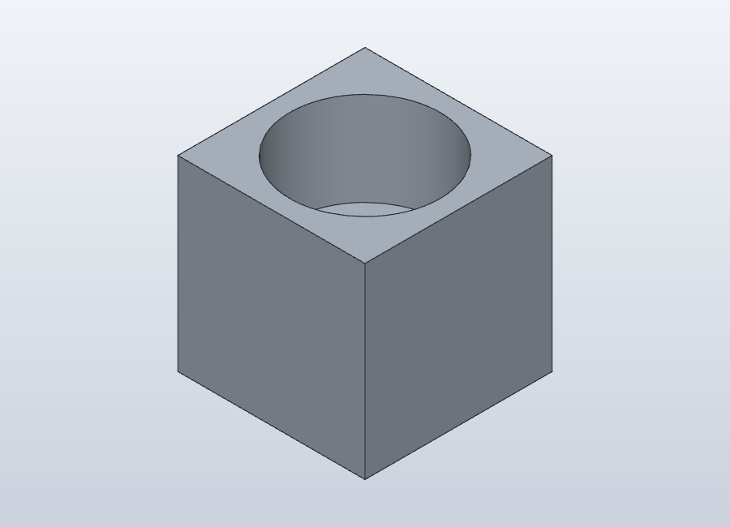 | [blind-hole-cube](parts/blind-hole-cube/) | Cube with a centered round blind hole reaching half way down | [sc](parts/blind-hole-cube/blind-hole-cube.sc), [step](parts/blind-hole-cube/blind-hole-cube.step) | [View](https://app.solidcraft.io/?embed&open=https%3A%2F%2Fraw.githubusercontent.com%2Fteyd%2Fcads%2Fmain%2Fparts%2Fblind-hole-cube%2Fblind-hole-cube.sc) |
| 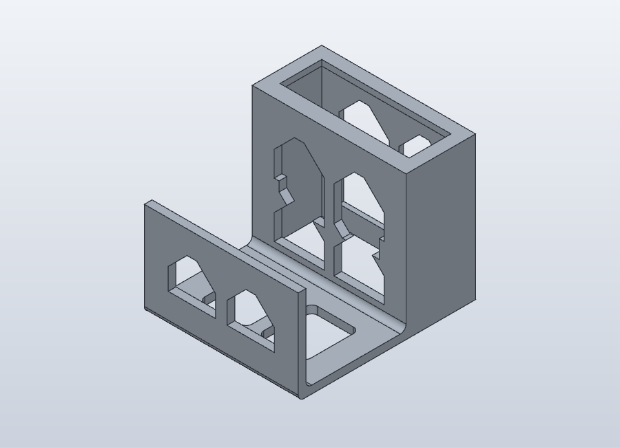 | [charger-bed-hook](parts/charger-bed-hook/) | Bed-frame hook with an open cage for a Ugreen 90747 desktop charger | [sc](parts/charger-bed-hook/charger-bed-hook.sc), [step](parts/charger-bed-hook/charger-bed-hook.step) | [View](https://app.solidcraft.io/?embed&open=https%3A%2F%2Fraw.githubusercontent.com%2Fteyd%2Fcads%2Fmain%2Fparts%2Fcharger-bed-hook%2Fcharger-bed-hook.sc) |
| 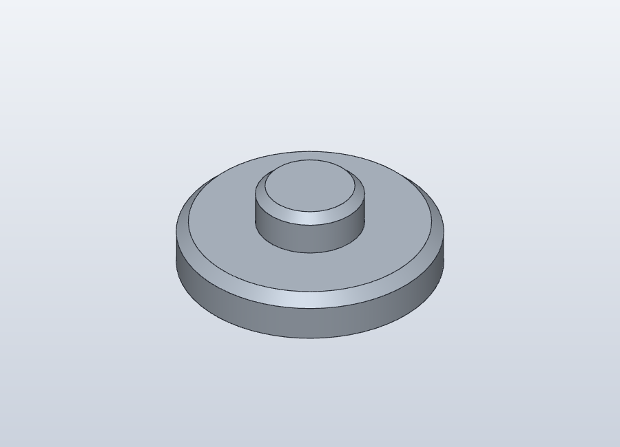 | [desk-caddy-foot](parts/desk-caddy-foot/) | Press-in TPU anti-slip foot for the desk device caddy | [sc](parts/desk-caddy-foot/desk-caddy-foot.sc), [step](parts/desk-caddy-foot/desk-caddy-foot.step) | [View](https://app.solidcraft.io/?embed&open=https%3A%2F%2Fraw.githubusercontent.com%2Fteyd%2Fcads%2Fmain%2Fparts%2Fdesk-caddy-foot%2Fdesk-caddy-foot.sc) |
| 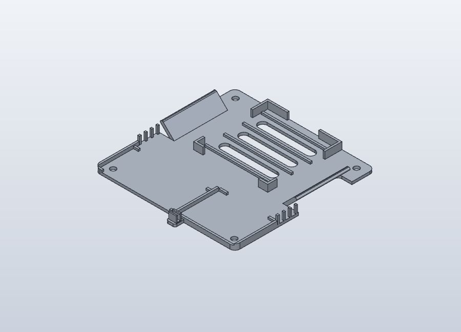 | [desk-device-caddy](parts/desk-device-caddy/) | Loose desktop tray for a 200 W GaN charger, a USB switch and a headphone DAC | [sc](parts/desk-device-caddy/desk-device-caddy.sc), [step](parts/desk-device-caddy/desk-device-caddy.step) | [View](https://app.solidcraft.io/?embed&open=https%3A%2F%2Fraw.githubusercontent.com%2Fteyd%2Fcads%2Fmain%2Fparts%2Fdesk-device-caddy%2Fdesk-device-caddy.sc) |
| 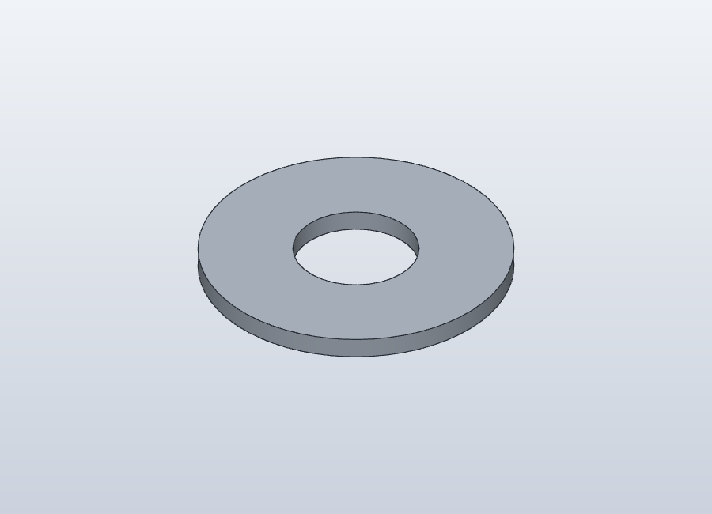 | [flat-ring](parts/flat-ring/) | Flat annular ring | [sc](parts/flat-ring/flat-ring.sc), [step](parts/flat-ring/flat-ring.step) | [View](https://app.solidcraft.io/?embed&open=https%3A%2F%2Fraw.githubusercontent.com%2Fteyd%2Fcads%2Fmain%2Fparts%2Fflat-ring%2Fflat-ring.sc) |
| 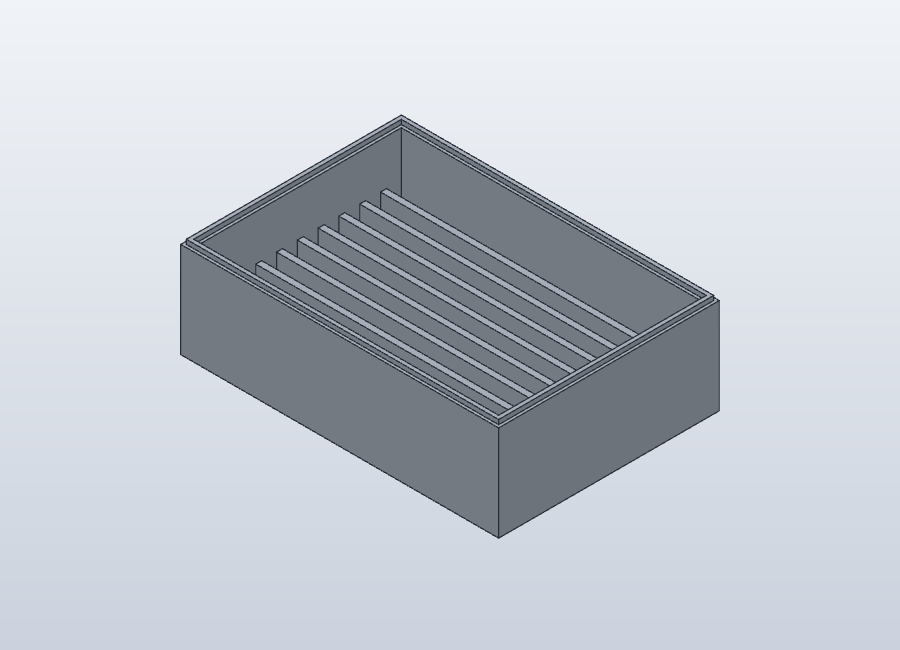 | [nvme-stack-case](parts/nvme-stack-case/) | Stackable case for ten M.2 2280 NVMe drives | [sc](parts/nvme-stack-case/nvme-stack-case.sc), [step](parts/nvme-stack-case/nvme-stack-case.step) | [View](https://app.solidcraft.io/?embed&open=https%3A%2F%2Fraw.githubusercontent.com%2Fteyd%2Fcads%2Fmain%2Fparts%2Fnvme-stack-case%2Fnvme-stack-case.sc) |
| 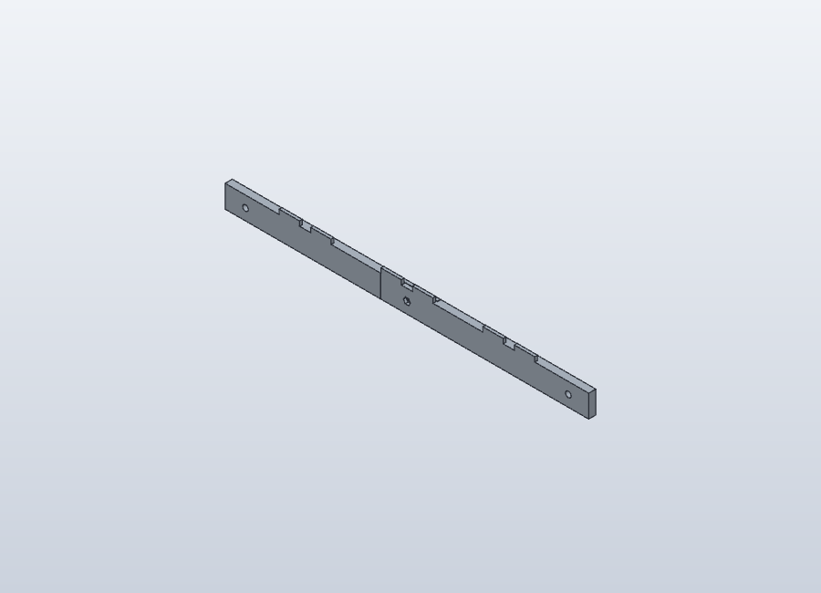 | [shelf-bin-rail](parts/shelf-bin-rail/) | Two-piece flat shelf side rail with short hanging prongs for 100 mm storage bins | [sc](parts/shelf-bin-rail/shelf-bin-rail.sc), [step](parts/shelf-bin-rail/shelf-bin-rail.step) | [View](https://app.solidcraft.io/?embed&open=https%3A%2F%2Fraw.githubusercontent.com%2Fteyd%2Fcads%2Fmain%2Fparts%2Fshelf-bin-rail%2Fshelf-bin-rail.sc) |
| 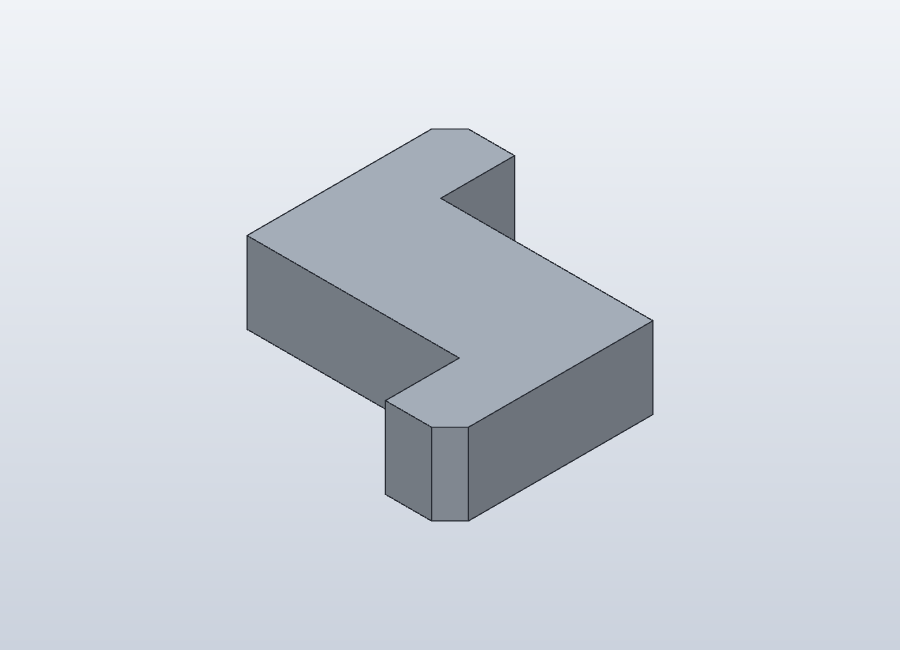 | [skadis-bin-clip](parts/skadis-bin-clip/) | Double hook that hangs skadis-screw-bin on a SKADIS board, two per bin | [sc](parts/skadis-bin-clip/skadis-bin-clip.sc), [step](parts/skadis-bin-clip/skadis-bin-clip.step) | [View](https://app.solidcraft.io/?embed&open=https%3A%2F%2Fraw.githubusercontent.com%2Fteyd%2Fcads%2Fmain%2Fparts%2Fskadis-bin-clip%2Fskadis-bin-clip.sc) |
| 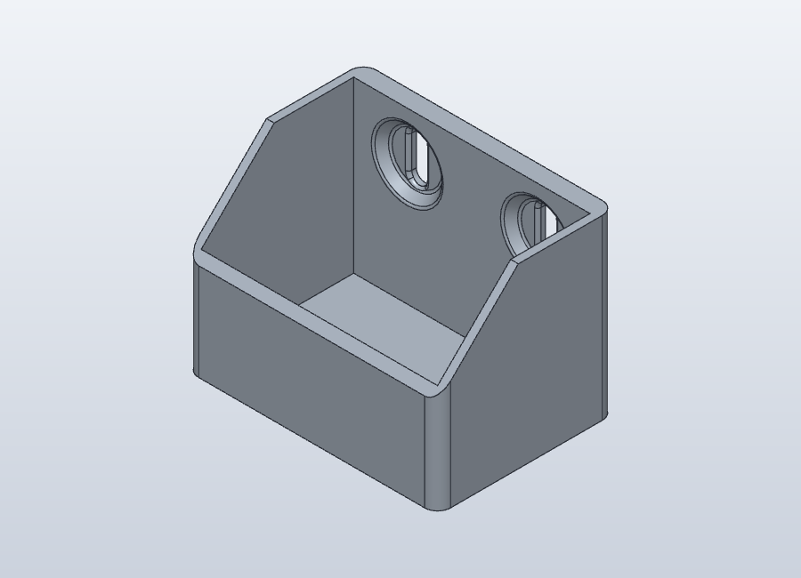 | [skadis-screw-bin](parts/skadis-screw-bin/) | SKADIS bin for screws and nuts, hung on two skadis-bin-clip parts | [sc](parts/skadis-screw-bin/skadis-screw-bin.sc), [step](parts/skadis-screw-bin/skadis-screw-bin.step) | [View](https://app.solidcraft.io/?embed&open=https%3A%2F%2Fraw.githubusercontent.com%2Fteyd%2Fcads%2Fmain%2Fparts%2Fskadis-screw-bin%2Fskadis-screw-bin.sc) |
| 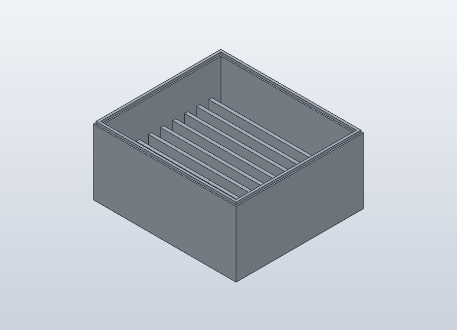 | [sodimm-stack-case](parts/sodimm-stack-case/) | Stackable case for ten SO-DIMM RAM modules | [sc](parts/sodimm-stack-case/sodimm-stack-case.sc), [step](parts/sodimm-stack-case/sodimm-stack-case.step) | [View](https://app.solidcraft.io/?embed&open=https%3A%2F%2Fraw.githubusercontent.com%2Fteyd%2Fcads%2Fmain%2Fparts%2Fsodimm-stack-case%2Fsodimm-stack-case.sc) |
| 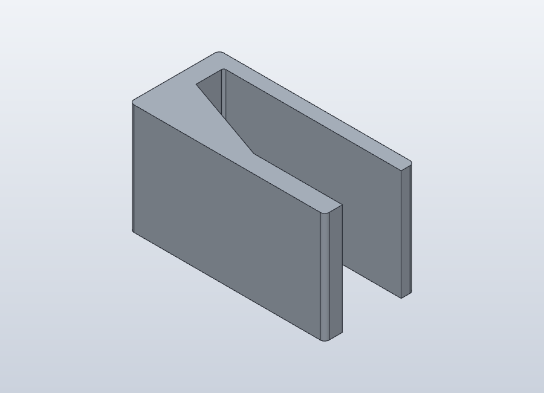 | [swiss-edge-clamp-wedge](parts/swiss-edge-clamp-wedge/) | Clamp jaw that squares off a Swiss-edge tabletop for monitor arms | [sc](parts/swiss-edge-clamp-wedge/swiss-edge-clamp-wedge.sc), [step](parts/swiss-edge-clamp-wedge/swiss-edge-clamp-wedge.step) | [View](https://app.solidcraft.io/?embed&open=https%3A%2F%2Fraw.githubusercontent.com%2Fteyd%2Fcads%2Fmain%2Fparts%2Fswiss-edge-clamp-wedge%2Fswiss-edge-clamp-wedge.sc) |
<!-- parts:end -->

Each part is `parts/<name>/<name>.sc` (the source) with `.step` and `.png` exports. Units are millimeters. The table is generated by `python3 update_readme.py`.
