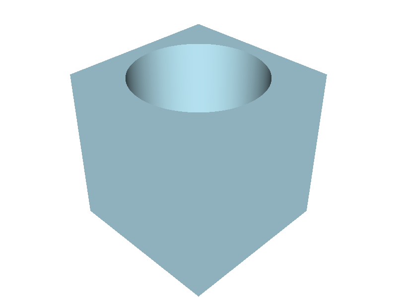
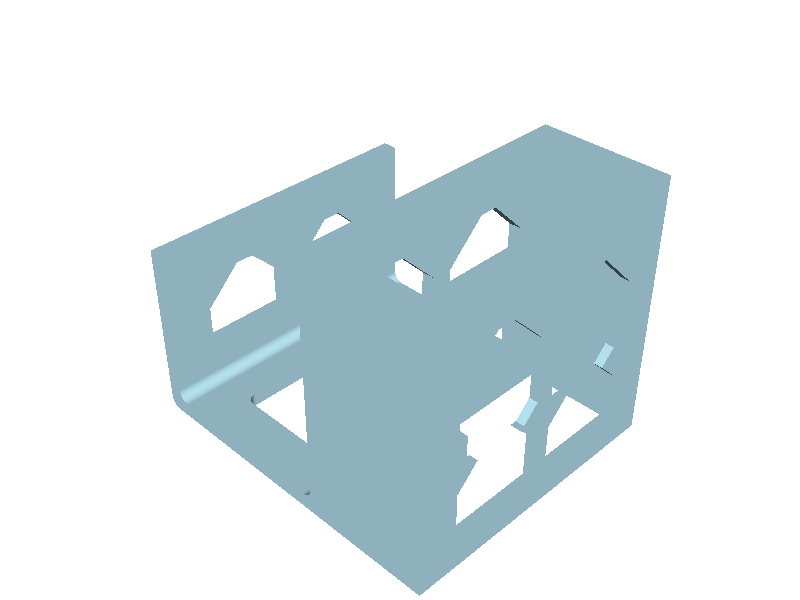
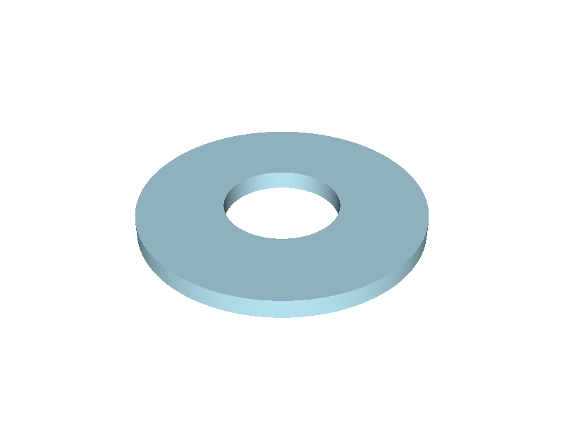
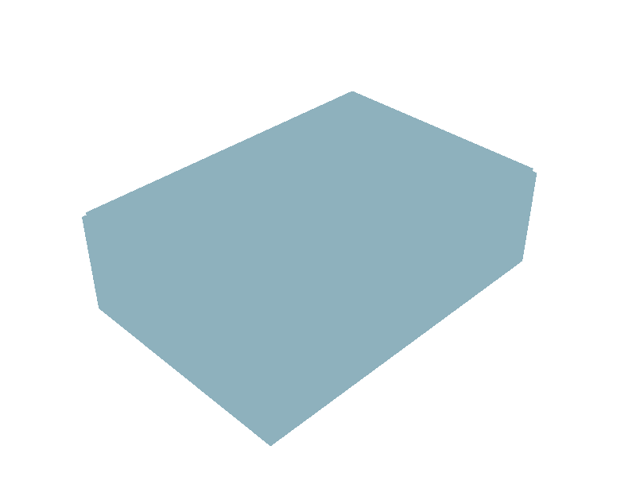
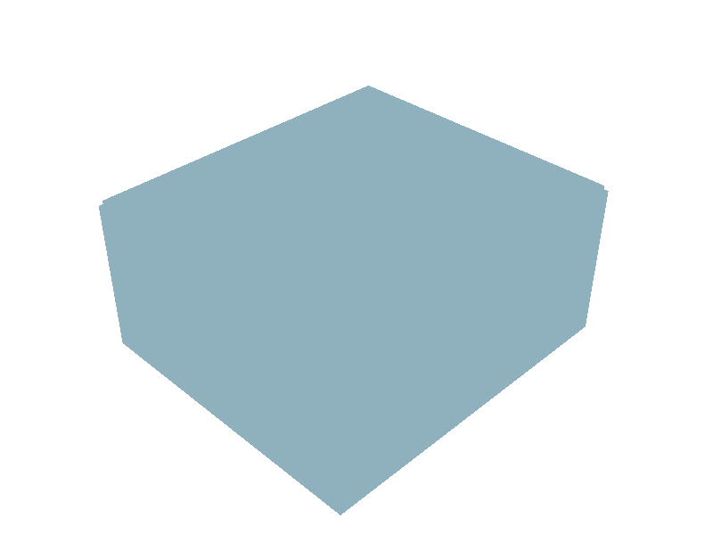

# cads

Parametric CAD parts as [build123d](https://github.com/gumyr/build123d) scripts. Describe a part to your coding agent, and it writes the script and exports the STEP file.

## How to

Paste this to your AI coding agent:

```text
Set up https://github.com/teyd/cads for me. Install mise (https://mise.jdx.dev/, a tool version manager) if it is missing and make sure it is on my PATH, clone the repo, run `mise install` inside it, and follow AGENTS.md from then on. When setup is done, ask me which part I want to build.
```

Or do it by hand:

```sh
brew install mise # add mise to path
git clone https://github.com/teyd/cads.git
cd cads
mise install
opencode # v2
```

Then describe the part you want. The agent follows `AGENTS.md`.

When it is done, open `parts/<name>/<name>.step` in a slicer such as [OrcaSlicer](https://github.com/SoftFever/OrcaSlicer) and print it.

## Parts

<!-- parts:start -->
| Preview | Part | Description | Files | 3D view |
| --- | --- | --- | --- | --- |
|  | [blind-hole-cube](parts/blind-hole-cube/) | Cube with a centered round blind hole reaching half way down | [py](parts/blind-hole-cube/blind-hole-cube.py), [step](parts/blind-hole-cube/blind-hole-cube.step) | [View](https://3dviewer.net/#model=https://raw.githubusercontent.com/teyd/cads/main/parts/blind-hole-cube/blind-hole-cube.step) |
|  | [charger-bed-hook](parts/charger-bed-hook/) | Bed-frame hook with an open cage for a Ugreen 90747 desktop charger | [py](parts/charger-bed-hook/charger-bed-hook.py), [step](parts/charger-bed-hook/charger-bed-hook.step) | [View](https://3dviewer.net/#model=https://raw.githubusercontent.com/teyd/cads/main/parts/charger-bed-hook/charger-bed-hook.step) |
|  | [flat-ring](parts/flat-ring/) | Flat annular ring | [py](parts/flat-ring/flat-ring.py), [step](parts/flat-ring/flat-ring.step) | [View](https://3dviewer.net/#model=https://raw.githubusercontent.com/teyd/cads/main/parts/flat-ring/flat-ring.step) |
|  | [nvme-stack-case](parts/nvme-stack-case/) | Stackable case for ten M.2 2280 NVMe drives | [py](parts/nvme-stack-case/nvme-stack-case.py), [step](parts/nvme-stack-case/nvme-stack-case.step) | [View](https://3dviewer.net/#model=https://raw.githubusercontent.com/teyd/cads/main/parts/nvme-stack-case/nvme-stack-case.step) |
|  | [sodimm-stack-case](parts/sodimm-stack-case/) | Stackable case for ten SO-DIMM RAM modules | [py](parts/sodimm-stack-case/sodimm-stack-case.py), [step](parts/sodimm-stack-case/sodimm-stack-case.step) | [View](https://3dviewer.net/#model=https://raw.githubusercontent.com/teyd/cads/main/parts/sodimm-stack-case/sodimm-stack-case.step) |
<!-- parts:end -->

Each part is `parts/<name>/<name>.py` (the source) and `parts/<name>/<name>.step` (the export). Units are millimeters. The table is generated by `update_readme.py`.

## License

[MIT](LICENSE). It covers the scripts and the models.
